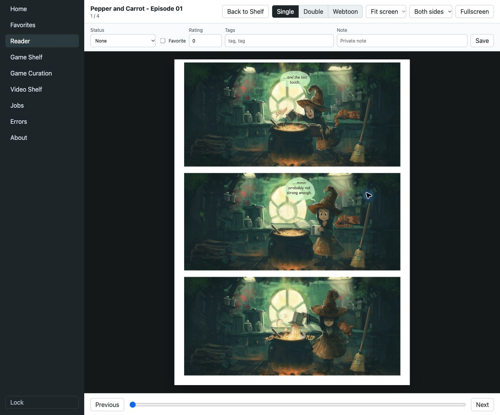
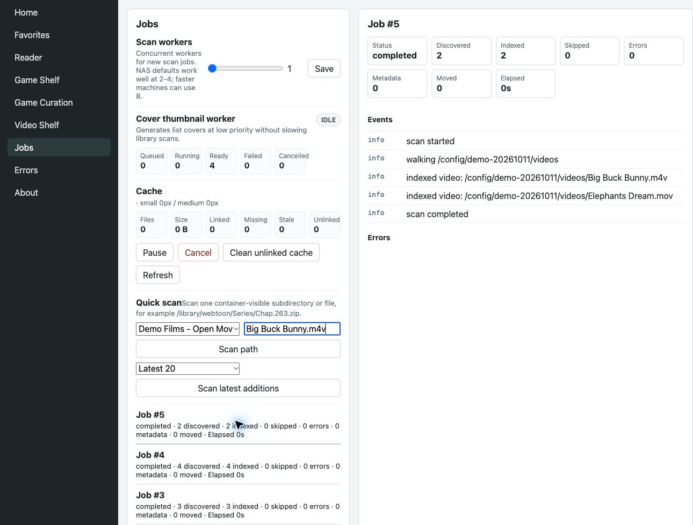

# FolioSpace Library

[English](README.md) · [官网](https://foliospace.app/) · [Docker Hub](https://hub.docker.com/r/funland/foliospace-library) · [Client API](docs/api/client-v1.md) · [中文接入摘要](docs/api/client-v1.zh-CN.md) · [MCP](docs/mcp/usage.md)

FolioSpace Library 是串联 **FolioSpace Reader、FolioLume Player、SpatialEMU** 的可选自托管内容基础层。它通过 Docker/Compose 运行在 Mac、Windows、Linux 电脑或兼容 NAS 上，索引你自己的电子书、PDF、漫画、游戏文件和本地视频，提供目录、元数据、媒体 URL、阅读进度及已实现的私人状态接口。

三款客户端负责阅读、观影和复古游戏体验，也都可以独立使用支持的文件或来源。Reader 和 SpatialEMU 已有 Library 接入；Library 已实现视频目录、直接/Range 传输及轻量 HLS 接口，更深入的 Player 整合仍属未来工作。服务端收录某种格式，并不保证每款客户端都能播放。

**欢迎其他客户端接入。** 你可以用 [Client API v1](docs/api/client-v1.md#external-client-quick-start) 开发阅读器、目录浏览器、游戏前端或媒体客户端。已有接口保持稳定兼容，新增字段按能力发现处理；具体互通仍需验证实际客户端与媒体。

当前版本：[1.02](https://github.com/funland/foliospace-Library/releases/tag/v1.02)。完整开发说明、环境配置与历史版本记录见 [英文 README](README.md)。

## 产品与下载

| 产品 | 个人内容体验 | 官方入口 |
| --- | --- | --- |
| **FolioSpace Reader** | iPhone、iPad、Apple Vision Pro 原生阅读器，阅读 EPUB、PDF、漫画和条漫；可导入本地文件离线阅读，也可选择连接 Library。 | [App Store](https://apps.apple.com/app/id6765784590) · [产品官网](https://reader.foliospace.app/) |
| **FolioLume Player** | 管理和观看个人影片收藏，支持兼容的本地/网络来源及蓝光 ISO/BDMV 播放和菜单。当前商店列出 iPhone、iPad、Mac、Apple Vision Pro、Apple TV，实际能力受设备、编码与版本影响。 | [App Store](https://apps.apple.com/app/id6812153528) · [产品官网](https://foliolume.app/) |
| **SpatialEMU** | 使用自己的兼容复古游戏文件，可本地导入，也可浏览 Library 目录、同步支持的存档和游玩记录。Apple 客户端覆盖 iPhone、iPad、Vision Pro、Apple TV、Apple silicon Mac；Windows 为独立下载。 | [App Store](https://apps.apple.com/app/id6771768889) · [产品官网](https://spatialemu.com/) · [下载页](https://spatialemu.com/downloads/) |

平台信息于 2026-10-10 对照官方站点与商店核实，当前设备和地区可用性以 App Store 为准。Reader 官网介绍的是原生应用；Library 自带的 Web 阅读器由你自己的服务提供。Player 的蓝光能力不代表 Library 视频 API 已支持原盘目录和菜单。MCP 现有能力用于目录发现、manifest、状态和扫描操作，一句话下载并播放仍不是已实现的产品能力。

Library 不提供第三方内容目录、书籍、影片、ROM、BIOS 或固件。它只索引和传输你提供、拥有合法使用权限的文件。照片和更广泛的空间媒体索引仍属产品方向。许可见 [LICENSE](LICENSE)，英文 README 保留完整许可说明。

## 开始使用

1. 按 [Docker 到 SpatialEMU 新手教程](docs/spatialemu-quickstart.zh-CN.md) 或 [Compose 指南](COMPOSE-QUICKSTART.md) 准备持久可写的 `/config` 及只读媒体挂载。
2. 启动服务并打开 `http://<Docker 主机>:8080`，完成首次设置，创建 token 和资料库。
3. 在支持的客户端中填写服务地址及同一 token。无需 NAS，也无需修改代码；Library 目前通过 Linux AMD64/ARM64 Docker 镜像运行，没有独立原生 macOS 服务端应用。

环境变量 `FOLIOSPACE_API_TOKEN` 非空时优先使用它；为空时，首次设置保存的 token 哈希仍会启用认证。不要把空环境变量理解为关闭认证。跨不可信网络使用 HTTPS，客户端用 Bearer header 传 token，并保存在系统钥匙串等安全存储中。

## 开发其他客户端

[中文 API 接入摘要](docs/api/client-v1.zh-CN.md) 给出最短流程和限制；[英文 API 参考](docs/api/client-v1.md) 包含请求、响应、分页、错误、进度、游戏及视频 manifest。

- 先读 `/api/auth/status`、`/api/client/info`，按实际能力启用功能。
- 首页只有有限 shelves，完整目录通过 books/games/videos 分页接口获取。
- 媒体 URL 是不透明服务 URL，必须保留 query 和编码；不要从路径字段重建下载地址。
- book/game/video DTO 不暴露源文件路径，但 collection 仍有 legacy `directoryPath`，应视为敏感元数据并在共享日志中脱敏。
- profile 是共享实例内的状态分区，不是独立账户或访问权限隔离。
- 正常服务启动默认关闭 resolver，Dockerfile/Compose 未覆盖该配置；直接构造 HTTP Server 的默认值不同，因此以能力发现为准。不要绕过运行时兼容性冲突。

## 界面截图

以下为 2026-10-11 从用户确认的测试环境取得的真实英文界面截图，内容采用公有领域或开放许可演示素材。完整英文截图见 [Screenshots](README.md#screenshots)，素材来源、署名和视频预览界面的版本区别见 [截图记录](docs/screenshots/README.md)。它们展示内置 Web 阅读与管理界面，不代表原生客户端互通或模拟器可玩性验证；API 文档仍以公开 main / 1.02 为准。

Pepper&Carrot 作者 David Revoy，采用 [CC BY 4.0](https://creativecommons.org/licenses/by/4.0/)；英文校对 Amireeti、Alex Gryson。

