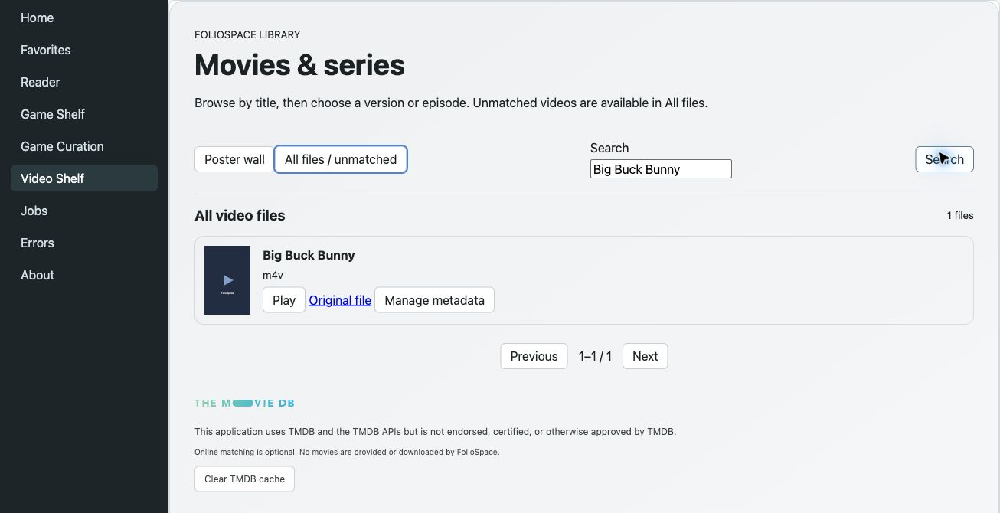

# Screenshot provenance and demonstration content

The six JPEG captures below were taken in Chrome on 2026-10-11 from the owner's confirmed, authenticated **test instance**, with English menus and controls. Captures are real browser output, cropped to omit the address/profile bar and unrelated catalog entries. No interface pixels were fabricated. The scan capture contains only the three new demonstration jobs; the visible paths refer to these new test fixtures, not a private NAS collection.

The test deployment reports version **1.02** but also contains a **video web UI preview**. The video capture is labeled separately: its title/version/metadata interface is not evidence that those preview surfaces ship in public 1.02. The [API reference](../api/client-v1.md) describes public main / v1.02 (`2333ee57`), with runtime capability discovery required. About labels are a human-readable subset; use `/api/client/info` for the full contract.

| Capture | What it demonstrates |
| --- | --- |
| [Comic reader](demo-reader-en.jpg) | Pepper&Carrot page 1, English reading controls and an empty private-state form. |
| [EPUB reader](demo-epub-en.jpg) | Alice's Adventures in Wonderland, Chapter I, rendered through the web EPUB reader. |
| [Game shelf](demo-games-en.jpg) | UCity catalog entry with the author's original screenshot as artwork. No ROM was executed. |
| [Scan jobs](demo-scan-jobs-en.jpg) | Three completed scans: 3 books/comics, 4 homebrew/test ROMs, 2 films; each reports zero errors. |
| [About](library-capabilities-en.jpg) | Reported version, formats, and visible service capability labels. |
| [Video UI preview](demo-videos-preview-en.jpg) | Filtered Big Buck Bunny file entry on the test deployment's preview UI. No private titles are shown. |

## Source and attribution

The owner requested safe demonstration content for this test instance. Only new fixtures and their catalog records were added. The original films, EPUBs, ROMs, source archives, and license notices are retained on that test instance; they are **not bundled with the server or this repository**. This documents provenance rather than a built-in content download feature.

| Content | Attribution and license | Official source |
| --- | --- | --- |
| Alice's Adventures in Wonderland, EPUB | Lewis Carroll; Project Gutenberg identifies this edition as public domain in the USA. Original EPUB and included Gutenberg notice retained. | [Book 11](https://www.gutenberg.org/ebooks/11) |
| Pride and Prejudice, EPUB | Jane Austen; Project Gutenberg identifies this edition as public domain in the USA. Original EPUB and included Gutenberg notice retained. | [Book 1342](https://www.gutenberg.org/ebooks/1342) |
| Pepper&Carrot, Episode 1: The Potion of Flight, CBZ | Art and story © David Revoy; English proofreading Amireeti and Alex Gryson. [CC BY 4.0](https://creativecommons.org/licenses/by/4.0/). Published JPEG pages are unmodified and packaged as CBZ, with attribution inside the archive. The reader capture displays an excerpt of the original page. | [Episode 1](https://www.peppercarrot.com/en/webcomic/ep01_Potion-of-Flight.html) · [License and credits](https://www.peppercarrot.com/en/about/index.html) |
| UCity v1.3, GBC, and its original screenshot | Antonio Niño Díaz / AntonioND / SkyLyrac. GPL-3.0-or-later code; [CC BY-SA 4.0](https://creativecommons.org/licenses/by-sa/4.0/) graphics/music, including the screenshot shown in the game capture. Bundled components keep their original terms, including BSD-2-Clause GBT Player. Matching v1.3 source archive and license notices retained. | [Official v1.3 release](https://github.com/AntonioND/ucity/releases/tag/v1.3) · [Tagged license statement](https://github.com/AntonioND/ucity/blob/v1.3/readme.rst#license) |
| 144p / 160p / 240p Test Suite v0.23, GB / GBA / NES | Damian Yerrick (pinobatch), based on Artemio Urbina's 240p Test Suite. GPL-2.0-or-later; matching source archive and GPL notice retained. Diagnostic homebrew ROMs, not commercial games. | [Official v0.23 release](https://github.com/pinobatch/240p-test-mini/releases/tag/v0.23) · [License](https://github.com/pinobatch/240p-test-mini/blob/v0.23/LICENSE) |
| Big Buck Bunny, complete M4V | © 2008 Blender Foundation, [www.bigbuckbunny.org](https://www.bigbuckbunny.org/). [CC BY 3.0](https://creativecommons.org/licenses/by/3.0/). Official 640×360 download, unmodified, including the entire credits roll. | [Copyright and sharing](https://peach.blender.org/about/) · [Official download index](https://download.blender.org/peach/bigbuckbunny_movies/) |
| Elephants Dream, complete MOV | © 2006 Blender Foundation / Netherlands Media Art Institute / [www.elephantsdream.org](https://www.elephantsdream.org/). [CC BY 2.5](https://creativecommons.org/licenses/by/2.5/). Official 480p download, unmodified, including the entire credits roll. | [Copyright and sharing](https://orange.blender.org/blog/creative-commons-license-2/) · [Official download index](https://download.blender.org/ED/) |

Open licenses retain copyright and require their stated attribution/redistribution terms. Gutenberg's stated public-domain status is jurisdiction-specific. Embedded media in these captures retain the licenses above; this provenance record does not change the repository's software license or imply endorsement by the creators.

## Verification limits

- All nine indexed fixtures were copied with recorded SHA-256 checksums verified on the test host; [content manifest](demo-content-manifest.json). The additional UCity artwork came unchanged from its tagged source archive.
- Both EPUB ZIP structures and the CBZ archive passed integrity checks. The comic and one EPUB chapter were visibly rendered in the browser.
- The four ROMs were recognized as NES, GB, GBC, and GBA, and indexed with checksums. UCity's local artwork match completed successfully. Neither ROMs nor downloaded source code were executed; no native-client or emulator gameplay certification is implied.
- Existing `ffprobe` identified H.264/AAC in both complete films: Big Buck Bunny 596.46 seconds, Elephants Dream 658.32 seconds. Their catalog scan completed with zero errors. Full browser/native playback and Blu-ray interoperability were not tested.
- Older PNG assets remain for historical references. The overview now uses the newly captured English JPEGs.

## Video UI preview

This is the test deployment's web UI preview, not a public 1.02 title/metadata API promise. Big Buck Bunny © Blender Foundation, CC BY 3.0; the full credits remain in the test media file.
